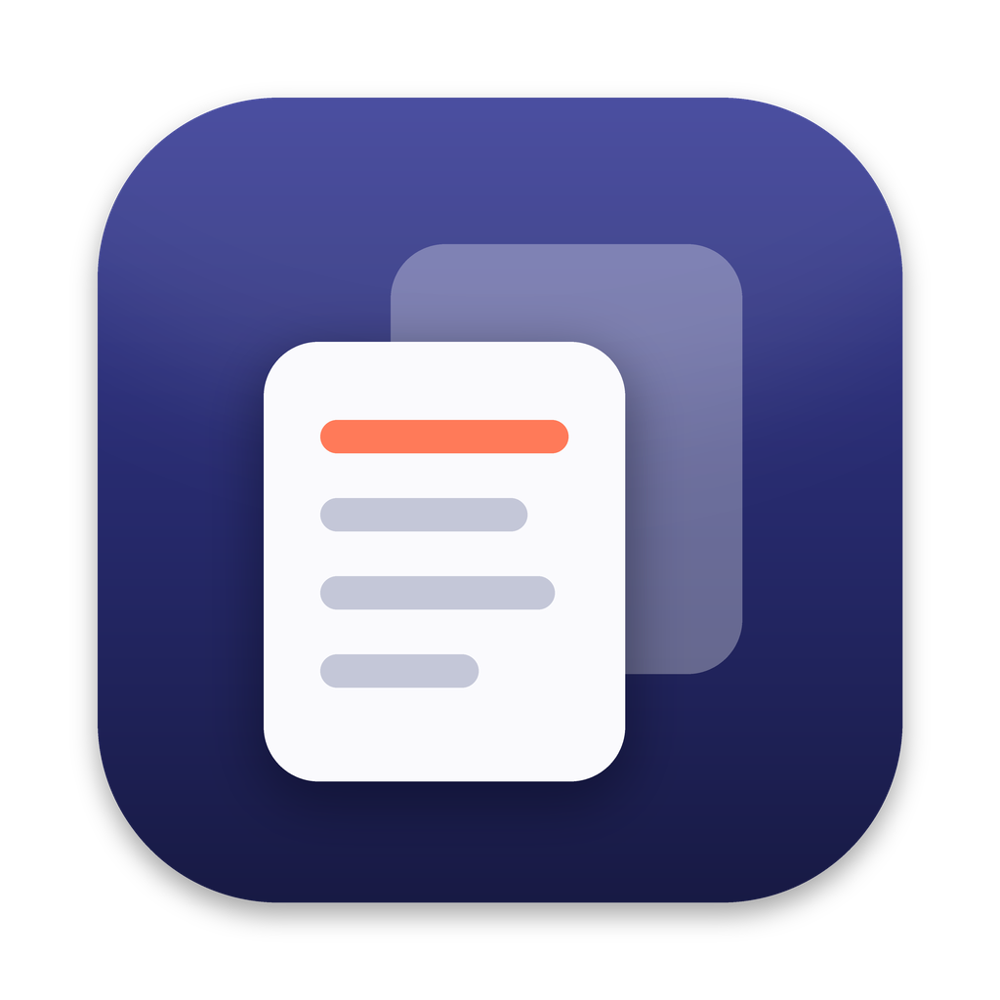
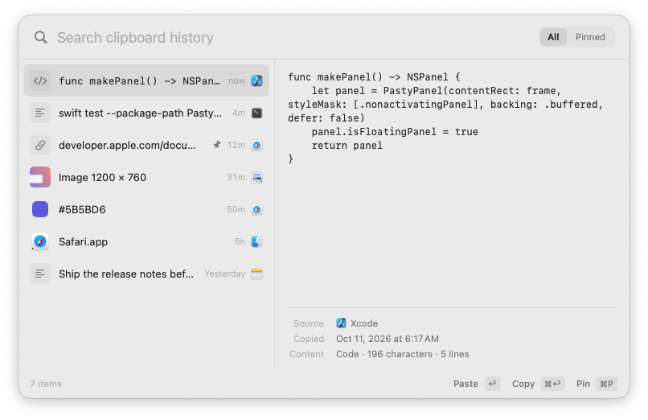
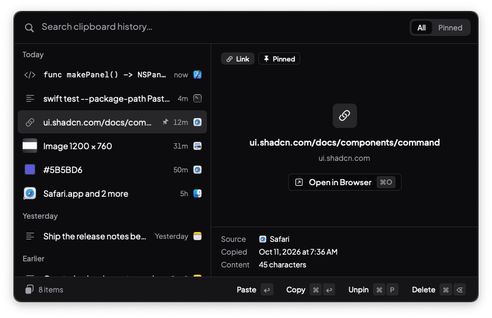
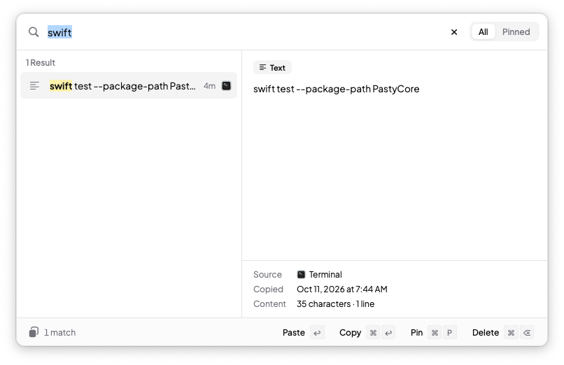
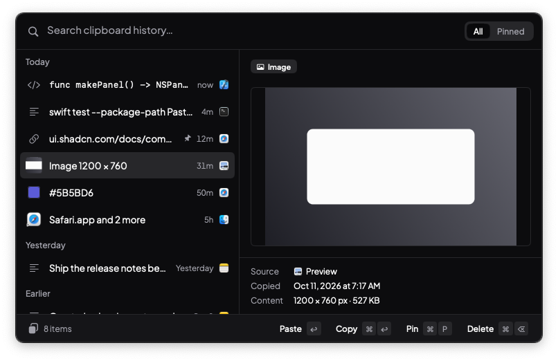
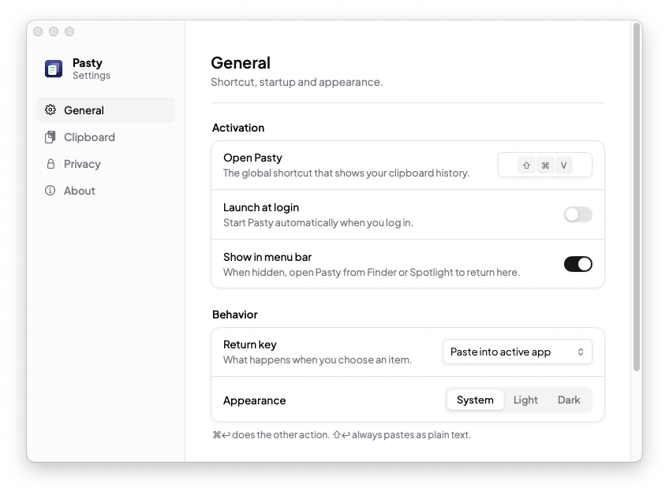
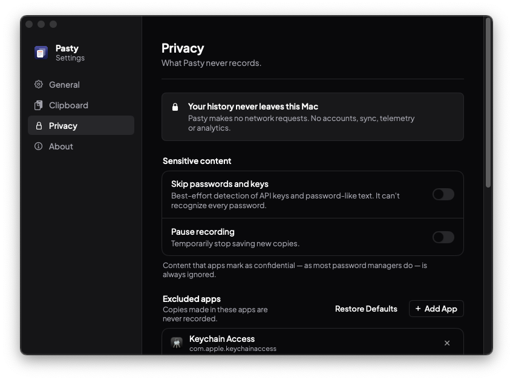
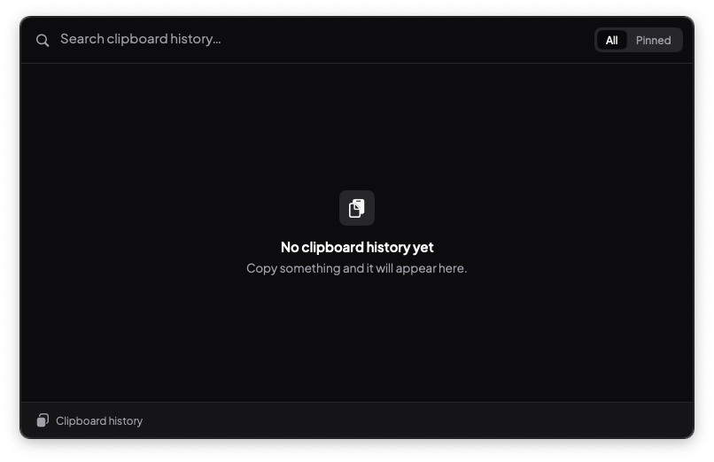
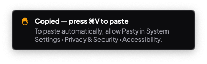

# Pasty

A fast, quiet clipboard history manager for macOS. Pasty lives in the menu bar, records what you copy, and brings it back with **⌘⇧V**: type to search, press **Return** to paste into the app you were using.

<p align="center"></p>

<p align="center">
  
  
</p>
<p align="center">
  
  
</p>
<p align="center">
  
  
</p>
<p align="center">
  
  
</p>
<p align="center"><sub>Screenshots are captured automatically by the CI smoke test from the real app.</sub></p>

- Native Swift 6, SwiftUI and AppKit. No web views, no third-party packages.
- Designed with the [shadcn/ui](https://ui.shadcn.com) design system (zinc theme), rebuilt natively in SwiftUI, and set in [Plus Jakarta Sans](https://fonts.google.com/specimen/Plus+Jakarta+Sans).
- Local-first. History is stored in SQLite on your Mac and never sent anywhere.
- Keyboard-first. Every action has a key.

## Requirements

- macOS 14 Sonoma or later, on Apple Silicon or Intel (universal binary)
- Xcode 16 or later to build (Swift 6 language mode)

## Install or update

Paste this into Terminal. The same command installs Pasty, or updates an existing copy to the latest release:

```bash
curl -fsSL https://raw.githubusercontent.com/krsambhav/pasty/main/scripts/install.sh | bash
```

[`scripts/install.sh`](scripts/install.sh) does the following:
1. Downloads the latest [release](https://github.com/krsambhav/pasty/releases/latest) and verifies its SHA-256 checksum.
2. Quits Pasty if it's running, replaces `/Applications/Pasty.app`, and opens it.

Requires macOS 14 Sonoma or later, on Apple Silicon or Intel. After that, Pasty **updates itself** in the background (see [Updates](#updates)). You can also download `Pasty.zip` from the [Releases page](https://github.com/krsambhav/pasty/releases) and drag `Pasty.app` into Applications.

On first launch, press **⌘⇧V** to open Pasty. The first time you paste, macOS asks for **Accessibility** permission (System Settings › Privacy & Security › Accessibility). Pasty needs it to send ⌘V for you.

## Build & run

```bash
open Pasty.xcodeproj            # then ⌘R
# or from the command line:
scripts/build-app.sh            # → build/Release/Pasty.app (universal), build/Pasty.zip and its .sha256
open build/Release/Pasty.app
```

Unit tests for the core library (storage, search, capture, privacy, preferences, benchmarks):

```bash
swift test --package-path PastyCore     # or ⌘U in Xcode
```

End-to-end smoke test of the built app (real pasteboard, monitor, database, panel):

```bash
scripts/smoke-test.sh build/Release/Pasty.app
```

The project is signed ad-hoc ("Sign to Run Locally") so it builds without a developer account. To distribute it, set your team and a Developer ID in the target's *Signing & Capabilities*, then notarize.

> **Note:** macOS ties the Accessibility permission to the app's code signature. An ad-hoc signed build gets a new signature on every rebuild, so after rebuilding you may need to remove Pasty from **System Settings › Privacy & Security › Accessibility** and allow it again.

## Using Pasty

| Key | Action |
| --- | --- |
| **⌘⇧V** | Open or close Pasty (change it in Settings) |
| Type | Search instantly |
| **↑ / ↓**, **⌘↑ / ⌘↓**, **Page Up/Down** | Move the selection |
| **Return** | Paste into the previous app (or copy, if you change it in Settings) |
| **⌘Return** | The other action: copy only, or paste |
| **⇧Return** | Paste as plain text |
| **⌘1 … ⌘9** | Paste the first nine items directly. Hold ⌘ to see the numbers. |
| **Tab** | Switch between All and Pinned |
| **⌘P** | Pin or unpin |
| **⌘⌫** | Delete the item |
| **⌘C** | Copy the item (unless text in the search field is selected) |
| **⌘O** | Open a link, or reveal a file in Finder |
| **⌘,** | Settings |
| **Esc** | Close |

Click an item to select it and see its full preview. Double-click (or press Return) to paste it. Right-click for the full set of actions.

### Paste permission

Pasting into another app works by sending it a ⌘V keystroke, which macOS only allows with **Accessibility** permission. The first time you paste, macOS asks for it. Until it's granted, Pasty still copies the item and tells you to press ⌘V yourself, so a paste never fails silently. You can check the status in **Settings › General**.

## Privacy

- History lives in `~/Library/Application Support/Pasty/History.sqlite`. No accounts, sync, telemetry or favicon fetching. The only network traffic is the update check and download from GitHub, which you can turn off.
- Content that apps mark as concealed, transient or auto-generated is never stored. This covers the [nspasteboard.org](http://nspasteboard.org) markers plus legacy 1Password and TypeIt4Me markers, which most password managers use.
- Password managers and Keychain Access are excluded by default. You can edit the list in **Settings › Privacy**.
- **Skip text that looks like a password or key** is an optional heuristic. It catches common API-key formats and short strings that mix every character class. It **cannot** reliably detect every password and doesn't claim to.
- **Pause recording** (menu bar or Settings): copies made while paused are discarded, not queued.
- **Clear History** asks for confirmation and can keep pinned items.

### macOS limitations, stated plainly

- macOS has no clipboard-change notification, so Pasty polls `NSPasteboard.changeCount`, a cheap integer read. Polling runs every 0.25 s right after activity and backs off to 1 s when idle. It stops while the Mac sleeps, and Pasty also checks immediately each time the panel opens. If several copies happen within one interval, only the last one is seen.
- The source app is best effort. Pasty uses the bundle ID an app declares (`org.nspasteboard.source`) if it gives one, otherwise the frontmost app when the change was noticed.

## Updates

Pasty updates itself from this repository's GitHub Releases:

1. **Check.** A minute after launch and then every 6 hours, Pasty fetches `releases/latest` from the GitHub API. This is the app's only network request; your clipboard never leaves the Mac. Turning off **Settings › About › Update automatically** stops background checks; **Check Now** and the menu bar's **Check for Updates…** still work.
2. **Download and verify.** `Pasty.zip` downloads in the background and must match the release's `Pasty.zip.sha256`. Once unpacked, the app must have Pasty's bundle identifier, the advertised build number, and a valid code signature. If the installed copy is certificate-signed, the new one must satisfy its *designated requirement*, meaning it was signed by the same certificate.
3. **Install when idle.** When the panel is closed and no Pasty window is open, a helper script waits for Pasty to quit, swaps the app bundle (rolling back if anything fails), and relaunches it. Any copy made during the restart is picked up when Pasty comes back. You can also use **Restart to Update** in the menu bar or in Settings.

**Releases.** CI builds `1.0.<run number>`, runs every test, and on `main` publishes the tested zip and its checksum as a GitHub release.

**Keep Accessibility permission across updates (recommended, one time).** macOS ties the Accessibility grant to the app's code signature. Ad-hoc builds get a new signature every time, so each update would need the permission granted again. Run this once on your Mac (it needs `gh`):

```bash
curl -fsSL https://raw.githubusercontent.com/krsambhav/pasty/main/scripts/create-signing-identity.sh | bash
```

The script creates a self-signed code-signing certificate and stores it as the `MACOS_SIGNING_P12` / `MACOS_SIGNING_PASSWORD` Actions secrets. From then on, every release is signed by that identity, and the permission survives updates. Install the first signed release manually once; signed copies only accept updates signed by the same certificate.

## Architecture

```
Pasty.xcodeproj
Pasty/                       App target (AppKit + SwiftUI)
  App/        PastyApp (entry, LSUIElement), AppCoordinator (wiring & lifecycle), StatusItemController
  Panel/      PanelController (non-activating NSPanel, keyboard routing), PanelModel (@Observable state)
  Views/      PanelRootView (search, footer, empty states), ClipListView/ClipRow, PreviewPane
  Services/   PasteCoordinator, HotKeyManager (Carbon), HUDController, SystemServices (AX, ⌘V, icons),
              Updater (GitHub Releases), FileThumbnails (QuickLook previews of copied files)
  Settings/   SettingsWindowController (sidebar layout), SettingsViews (General / Clipboard / Privacy / About)
  Design/     Theme (shadcn tokens, Plus Jakarta Sans), Components (Button, Switch, Tabs, Kbd, Badge, Card, Select, AlertDialog)
  Resources/  Assets (app icon), Fonts (Plus Jakarta Sans + OFL license)
  Support/    SmokeTest (end-to-end self check used by CI)
PastyCore/                   Swift package with no UI, fully unit-tested
  Storage/    ClipboardStore (actor; SQLite WAL + FTS5 trigram), SQLite (statement-caching wrapper)
  Capture/    ClipboardMonitor, PasteboardIO, ContentAnalyzer, PrivacyPolicy/SecretDetector
  Search/     SearchQuery, SearchRanker
  Models/     ClipItem, PasteboardSnapshot, HistorySections (Today / Yesterday / …), HexColor, RelativeTime
  Settings/   Preferences (@Observable, UserDefaults-backed), KeyCombo
  Updates/    UpdateFeed (release parsing, version comparison, SHA-256 verification)
```

**Capture pipeline.** `ClipboardMonitor` polls on a private utility queue. On a change it first checks the pasteboard *types* and the source app against the privacy rules, so nothing sensitive is ever read. Only then does it read the data, keeping every representation (RTF, HTML, PNG, file URLs, app-private types) within a size budget. It then classifies, hashes and thumbnails the entry, all off the main thread. Drafts go through an `AsyncStream` to a single consumer, which keeps inserts ordered during bursts of copies.

**Storage.** `ClipboardStore` is an actor that owns one SQLite connection: WAL, `synchronous=NORMAL`, incremental auto-vacuum, cached prepared statements. Representations are kept as blobs so an entry restores exactly as it was copied. List queries never touch blobs or long previews.

**Search.** FTS5 with the trigram tokenizer gives case-insensitive substring matching, including Unicode case folding ("école" finds "ÉCOLE"). Terms shorter than three characters fall back to `LIKE`, except non-ASCII ones ("é", "日本"), which are matched in Swift because SQLite's `LIKE` only folds ASCII. Candidates are ranked in this order: exact → prefix → whole word → substring → all terms → deeper in content → metadata only. Pinned items get a small boost and recency breaks ties. Stale queries are discarded with a generation counter, so typing never blocks the UI.

**Paste.** The panel is a *non-activating* `NSPanel`, so it takes keyboard focus without activating Pasty, and the app you were using stays frontmost. Choosing an item works like this:
1. Write the stored representations to the pasteboard on the monitor's queue. The monitor adopts the new change count, so Pasty never records its own write.
2. Hide the panel.
3. If the target app isn't frontmost (for example, you opened Pasty from the menu bar), activate it and wait for its activation notification. There is no fixed sleep. The check uses the frontmost application, not `NSApp.isActive`, which reads true whenever a non-activating panel is key.
4. Post ⌘V with explicit modifier flags, so a held ⇧ can't turn it into "Paste and Match Style".

**Design system.** shadcn/ui is a React library, so Pasty doesn't use its code. It reimplements its design language natively in `Pasty/Design`:
- `Theme.swift`: shadcn's zinc color tokens (`background`, `foreground`, `muted`, `accent`, `border`, `ring`, `primary`, `destructive`…) as dynamic colors that follow Light/Dark, its radius scale, and its type scale.
- `Components.swift`: `Button` (primary / secondary / outline / ghost / destructive / link, in sizes xs–md), `Switch`, `Tabs`, `Kbd`, `Badge`, `Card`, `Separator`, `Select`, `AlertDialog`, and a settings form row.

The panel follows shadcn's Command pattern: an input, grouped results, and right-aligned shortcuts. Toasts follow Sonner. **Plus Jakarta Sans** (SIL Open Font License, Regular/Medium/SemiBold/Bold) is bundled in `Pasty/Resources/Fonts` and registered for the process at launch. If registration ever fails, every text style falls back to the system font. Code previews use SF Mono. System-drawn menus (the menu bar menu and right-click menus) keep the native look; the menu bar menu also uses the bundled font.

**Global shortcut.** Carbon's `RegisterEventHotKey`. It needs no Accessibility or Input Monitoring permission. Registration conflicts are reported in Settings.

## Performance

Measured on GitHub's `macos-15` runners (Apple Silicon VMs, so slower than a typical Mac). Numbers come from `PerformanceTests` and the app smoke test, and the CI log prints them on every run:

| Metric | Result |
| --- | --- |
| Panel open (warm, 30 cycles) | **5.8 ms median**, 8.3 ms p95 |
| Panel first open after launch | 24 ms |
| Paste into TextEdit (choose item → ⌘V sent) | **~20 ms** |
| Load full 10,000-item list | ~10 ms median |
| Search, 10,000 items, one term | ~30–37 ms median (synthetic worst case: nearly every item matches) |
| Search, 10,000 items, two terms | ~61 ms median (same worst case; real histories match far fewer items) |
| Capture + thumbnail of a 5K screenshot | ~31 ms, off the main thread |
| Capture of 10 MB of text | ~220 ms, off the main thread |
| Copy → recorded in history | ~230 ms (the polling interval) |
| Idle CPU (10 s sample) | 0.04 % |
| Memory (physical footprint) | ~34 MB |
| 100 rapid open/close cycles | +6.5 MB, no leak trend |

**Huge entries.** These were measured end to end in the real app while a watchdog timed how late the main thread answered a ping every 5 ms (any UI stall shows up there):

| 10,000 lines of code (502 KB plain, 696 KB colored RTF) and a 10 MB single-line text | Result |
| --- | --- |
| Worst main-thread stall: capturing / opening / previewing / ↓-flicking / searching / copying back | 5 / 26 / 29 / 14 / 5 / 25 ms |
| Capture → in history | 170–300 ms (polling + off-main analysis) |
| Preview ready after selecting | 95–150 ms (built off the main thread; includes a 70 ms debounce for large items) |
| Search for text on line 10,000 | 0.3 ms in the store, 31 ms end to end |
| Analyze / index 10k-line code | 12 ms / 13 ms (background) |
| Paste (choose item → ⌘V sent) | 18–24 ms |

How huge entries stay smooth:
- **Analysis.** All capture work (reading, hashing, classifying, indexing up to 1M characters) runs off the main thread.
- **Previews.** Decoding, RTF parsing and styling happen on a background task. A TextKit 2 view then lays out only the visible lines. Previews show the first 300k characters, or 50k when lines are enormous (minified code); the full content is always what gets pasted.
- **Navigation.** Holding ↓ across large items debounces their previews and cancels stale loads.
- **Paste.** The panel dismisses immediately, and the clipboard write and plain-text conversion happen off the main thread.
- **Search box.** A wall of text pasted into the search field is bounded to 256 characters and 12 terms.

Techniques used: a pre-warmed panel rendered once off-screen at launch; `LazyVStack` with `Equatable` fixed-height rows; observation scoped so selection changes don't re-render the list content; thumbnails decoded at 160 px and cached; full images downsampled with ImageIO before display; prepared statements; and queries that skip blob columns.

## Testing

**107 unit tests** (`swift test --package-path PastyCore`) cover:
- **Change detection:** pre-existing content is ignored, each change is captured exactly once, rapid copies resolve to the latest, Pasty's own writes are ignored (even from an earlier session), paused copies are forgotten, a cleared pasteboard is skipped, rules change at runtime, the real timer captures and stops, and a restart picks up changes made while stopped (sleep/wake).
- **Content:** empty and whitespace-only text; emoji, ZWJ sequences, combining marks, RTL, CJK; CRLF line endings; NUL bytes; invalid UTF-8; RTF-only and HTML-only content (scripts and styles stripped); PDF and app-private data (kept and restored verbatim); corrupt and TIFF-only images; tiny images; text-plus-image spreadsheet cells; URL edge cases (IDN, localhost, `javascript:`, multi-line); file names with spaces and accents; hex colors (including full-width digits); relative times (including future dates); date grouping.
- **Storage:** duplicates (move-to-top, ignore-consecutive, keep-all, duplicate of a pinned item), retention (a zero limit, more pinned items than the limit), operations on missing IDs, 200 concurrent inserts, reads during writes, an 8 MB binary and empty blobs round-tripping byte-exact, reopening after clear and vacuum, corrupt-file recovery, WAL.
- **Search:** ranking order, recency ties, metadata and file names, SQL-injection and FTS-syntax queries, a 10,000-character query, Unicode case folding, short non-ASCII terms, emoji, matches beyond the preview, highlight ranges with emoji and combining marks.
- **Privacy:** concealed, transient, auto-generated and legacy markers; excluded apps; unknown sources; the secret heuristic; the size budget; promise and synthesized types.
- **Preferences:** defaults, persistence, corrupt stored values, clamping, an emptied exclusion list.
- **Benchmarks:** a 10,000-entry history.

**74 end-to-end checks** (`scripts/smoke-test.sh`) run against the built app on a throwaway database. With Accessibility granted, they drive real keystrokes through `CGEvent`:
- Fonts are registered and used.
- Panel placement is correct on six display layouts (negative coordinates, portrait, smaller than the panel).
- Capture works, including 20 rapid copies with no duplicates.
- 30 open/close cycles: timing, focus ready on open, panel is key, Pasty never becomes the frontmost app.
- The list updates while the panel is open, and the selection holds.
- Deleting selects the next item. The Pinned filter works, and unpinning updates it.
- Search covers no results, whitespace-only queries, and case-insensitive grouped results. The selection clamps at both ends.
- Copying an item back restores it exactly, creates no duplicate, and moves it to the top.
- Pause and resume, and simulated sleep/wake.
- The permission-denied path: it copies, reports failure, and shows a toast.
- Typing goes into the search field. ↑/↓, Tab and Esc work.
- The global shortcut opens and closes the panel.
- Pasting into TextEdit keeps TextEdit frontmost. Paste as plain text works into a rich document.
- Large content: 10,000 lines of code (plain and colored RTF) and a 10 MB single line are captured, previewed, navigated, searched to the last line, copied back byte-exact, and pasted into TextEdit, all under a main-thread stall watchdog.
- 100-cycle stress and leak check.
- Idle CPU stays under 1%.
- 19 screenshots of every surface in both appearances.

### Manual validation (needs a person and permissions)

These need real hardware or system state that CI can't provide:

1. **Other target apps:** paste into Terminal, Safari's address bar, Notes (an image), Finder (a copied file), and TextEdit with formatting kept. CI only exercises TextEdit, with plain and plain-text paste.
2. **Real permission denial:** remove Pasty from Accessibility and press Return. The system prompt should appear (CI simulates denial without the prompt).
3. **Full screen & Spaces:** open Pasty over a full-screen app and on another Space.
4. **Physical multiple displays:** placement math is tested on six layouts; confirm that the panel follows the pointer across real screens.
5. **Real sleep/wake:** CI simulates the workspace notifications. Close the lid, reopen it, copy, and check the item appears.
6. **Menu bar:** Pause/Resume (the icon shows pause bars), hide the icon, then reopen Pasty from Finder to get Settings.
7. **Launch at login:** toggle it in Settings and check **System Settings › General › Login Items**.
8. **Accessibility:** Reduce Motion (no fades) and VoiceOver (selection changes are announced).
