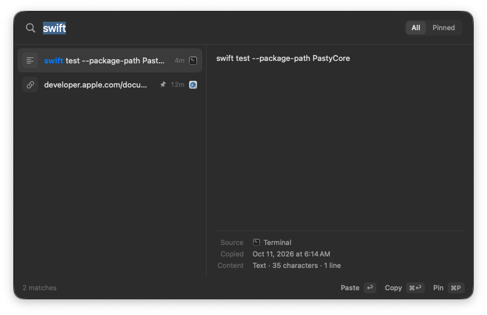
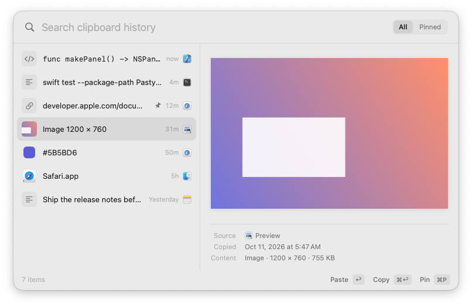

# Pasty

A fast, quiet clipboard history manager for macOS. Pasty lives in the menu bar, records what you copy, and brings it back with **⌘⇧V**: type to search, press **Return** to paste into the app you were using.

<p align="center"></p>

<p align="center">
  
  
</p>
<p align="center">
  
  
</p>
<p align="center"><sub>Screenshots are captured automatically by the CI smoke test from the real app.</sub></p>

- Native Swift 6, SwiftUI and AppKit. No web views, no third-party packages.
- Local-first. History is stored in SQLite on your Mac and never sent anywhere.
- Keyboard-first. Every action has a key.

## Requirements

- macOS 14 Sonoma or later, on Apple Silicon or Intel (universal binary)
- Xcode 16 or later to build (Swift 6 language mode)

## Build & run

```bash
open Pasty.xcodeproj            # then ⌘R
# or from the command line:
scripts/build-app.sh            # → build/Release/Pasty.app (universal) and build/Pasty.zip
open build/Release/Pasty.app
```

Unit tests for the core library (storage, search, capture, privacy, preferences, benchmarks):

```bash
swift test --package-path PastyCore     # or ⌘U in Xcode
```

End-to-end smoke test of the built app (real pasteboard, monitor, database, panel):

```bash
scripts/smoke-test.sh build/Release/Pasty.app
```

The project is signed ad-hoc ("Sign to Run Locally") so it builds without a developer account. To distribute it, set your team and a Developer ID in the target's *Signing & Capabilities*, then notarize.

> **Note:** macOS ties the Accessibility permission to the app's code signature. An ad-hoc signed build gets a new signature on every rebuild, so after rebuilding you may need to remove Pasty from **System Settings › Privacy & Security › Accessibility** and allow it again.

## Using Pasty

| Key | Action |
| --- | --- |
| **⌘⇧V** | Open or close Pasty (change it in Settings) |
| Type | Search instantly |
| **↑ / ↓**, **⌘↑ / ⌘↓**, **Page Up/Down** | Move the selection |
| **Return** | Paste into the previous app (or copy, if you change it in Settings) |
| **⌘Return** | The other action: copy only, or paste |
| **⇧Return** | Paste as plain text |
| **⌘1 … ⌘9** | Paste the first nine items directly. Hold ⌘ to see the numbers. |
| **Tab** | Switch between All and Pinned |
| **⌘P** | Pin or unpin |
| **⌘⌫** | Delete the item |
| **⌘C** | Copy the item (unless text in the search field is selected) |
| **⌘O** | Open a link, or reveal a file in Finder |
| **⌘,** | Settings |
| **Esc** | Close |

Click an item to paste it. Right-click for the full set of actions.

### Paste permission

Pasting into another app works by sending it a ⌘V keystroke, which macOS only allows with **Accessibility** permission. The first time you paste, macOS asks for it. Until it's granted, Pasty still copies the item and tells you to press ⌘V yourself, so a paste never fails silently. You can check the status in **Settings › General**.

## Privacy

- History lives in `~/Library/Application Support/Pasty/History.sqlite`. Pasty makes no network requests: no accounts, sync, telemetry or favicon fetching.
- Content that apps mark as concealed, transient or auto-generated is never stored. This covers the [nspasteboard.org](http://nspasteboard.org) markers plus legacy 1Password and TypeIt4Me markers, which most password managers use.
- Password managers and Keychain Access are excluded by default. You can edit the list in **Settings › Privacy**.
- **Skip text that looks like a password or key** is an optional heuristic. It catches common API-key formats and short strings that mix every character class. It **cannot** reliably detect every password and doesn't claim to.
- **Pause recording** (menu bar or Settings): copies made while paused are discarded, not queued.
- **Clear History** asks for confirmation and can keep pinned items.

### macOS limitations, stated plainly

- macOS has no clipboard-change notification, so Pasty polls `NSPasteboard.changeCount`, a cheap integer read. Polling runs every 0.25 s right after activity and backs off to 1 s when idle. It stops while the Mac sleeps, and Pasty also checks immediately each time the panel opens. If several copies happen within one interval, only the last one is seen.
- The source app is best effort. Pasty uses the bundle ID an app declares (`org.nspasteboard.source`) if it gives one, otherwise the frontmost app when the change was noticed.

## Architecture

```
Pasty.xcodeproj
Pasty/                       App target (AppKit + SwiftUI)
  App/        PastyApp (entry, LSUIElement), AppCoordinator (wiring & lifecycle), StatusItemController
  Panel/      PanelController (non-activating NSPanel, keyboard routing), PanelModel (@Observable state)
  Views/      PanelRootView (search, footer, empty states), ClipListView/ClipRow, PreviewPane
  Services/   PasteCoordinator, HotKeyManager (Carbon), HUDController, SystemServices (AX, ⌘V, icons)
  Settings/   SettingsWindowController (toolbar tabs), SettingsViews (General / Clipboard / Privacy)
  Support/    SmokeTest (end-to-end self check used by CI)
PastyCore/                   Swift package with no UI, fully unit-tested
  Storage/    ClipboardStore (actor; SQLite WAL + FTS5 trigram), SQLite (statement-caching wrapper)
  Capture/    ClipboardMonitor, PasteboardIO, ContentAnalyzer, PrivacyPolicy/SecretDetector
  Search/     SearchQuery, SearchRanker
  Settings/   Preferences (@Observable, UserDefaults-backed), KeyCombo
```

**Capture pipeline.** `ClipboardMonitor` polls on a private utility queue. On a change it first checks the pasteboard *types* and the source app against the privacy rules, so nothing sensitive is ever read. Only then does it read the data, keeping every representation (RTF, HTML, PNG, file URLs, app-private types) within a size budget. It then classifies, hashes and thumbnails the entry, all off the main thread. Drafts go through an `AsyncStream` to a single consumer, which keeps inserts ordered during bursts of copies.

**Storage.** `ClipboardStore` is an actor that owns one SQLite connection: WAL, `synchronous=NORMAL`, incremental auto-vacuum, cached prepared statements. Representations are kept as blobs so an entry restores exactly as it was copied. List queries never touch blobs or long previews.

**Search.** FTS5 with the trigram tokenizer gives case-insensitive substring matching. Terms shorter than three characters fall back to `LIKE`. Candidates are ranked in this order: exact → prefix → whole word → substring → all terms → deeper in content → metadata only. Pinned items get a small boost and recency breaks ties. Stale queries are discarded with a generation counter, so typing never blocks the UI.

**Paste.** The panel is a *non-activating* `NSPanel`, so it takes keyboard focus without activating Pasty, and the app you were using stays frontmost. Choosing an item works like this:
1. Write the stored representations to the pasteboard on the monitor's queue. The monitor adopts the new change count, so Pasty never records its own write.
2. Hide the panel.
3. If the target app isn't frontmost (for example, you opened Pasty from the menu bar), activate it and wait for its activation notification. There is no fixed sleep.
4. Post ⌘V with explicit modifier flags, so a held ⇧ can't turn it into "Paste and Match Style".

**Global shortcut.** Carbon's `RegisterEventHotKey`. It needs no Accessibility or Input Monitoring permission. Registration conflicts are reported in Settings.

## Performance

Measured on GitHub's `macos-15` runners (Apple Silicon VMs, so slower than a typical Mac). Numbers come from `PerformanceTests` and the app smoke test, and the CI log prints them on every run:

| Metric | Result |
| --- | --- |
| Panel open (warm, 30 cycles) | **5.0 ms median**, 7.8 ms p95 |
| Panel first open after launch | 26 ms |
| Search field focused on open | yes, verified |
| Load full 10,000-item list | ~10 ms median |
| Search, 10,000 items, single term | ~23–30 ms median (synthetic worst case: nearly every item matches) |
| Search, 10,000 items, two terms | ~52 ms median (same worst case; real histories match far fewer items) |
| Capture + thumbnail of a 5K screenshot | ~32 ms, off the main thread |
| Copy → recorded in history | ~220 ms (the polling interval) |
| Idle CPU (10 s sample) | 0.2 % |
| Memory (physical footprint) | ~21 MB |
| Paste into TextEdit via ⌘V | verified via the Accessibility API |

Techniques used: a pre-warmed panel rendered once off-screen at launch; `LazyVStack` with `Equatable` fixed-height rows; observation scoped so selection changes don't re-render the list content; thumbnails decoded at 160 px and cached; full images downsampled with ImageIO before display; prepared statements; and queries that skip blob columns.

## Testing

`swift test --package-path PastyCore` covers:
- **Change detection:** pre-existing content is ignored, each change is captured exactly once, rapid consecutive copies resolve to the latest, Pasty's own writes are ignored, copies made while paused are forgotten.
- **Duplicates:** move-to-top, ignore-consecutive, keep-all.
- **Retention:** the oldest unpinned items are trimmed and pinned items are never removed; clear with and without pinned items.
- **Search:** case-insensitive, partial, multi-term, short queries, ranking order, recency ties, metadata and file names, special characters and FTS operators, highlight ranges.
- **Persistence:** reopening the database, WAL mode, recovery from a corrupt file.
- **Serialization:** byte-exact round trips of multi-item, multi-type snapshots; rich text (bold survives); multiple files; images with thumbnail and dimensions; a 5K screenshot; 5.4 MB of text.
- **Privacy:** concealed, transient, auto-generated and legacy markers; excluded apps; images disabled; the secret heuristic; the size budget.
- **Preferences:** defaults, persistence across instances, shortcut validation.
- **Benchmarks:** a 10,000-entry history.

`scripts/smoke-test.sh` runs the built app against a throwaway database. It copies via the real general pasteboard, measures capture latency, makes 20 rapid copies, opens and closes the panel 30 times (checking timing and search-field focus), copies an entry back (checking an exact restore and no duplicate entry), and measures idle CPU over 10 s and memory footprint.

### Manual validation (needs a person and permissions)

These depend on the window server, other apps, or a human-granted Accessibility permission, so they are not automated:

1. **Paste into apps:** grant Accessibility, then paste with Return into TextEdit (rich text keeps its formatting), Terminal, Safari's address bar, Notes (an image), and Finder (a copied file).
2. **Permission denied:** remove Pasty from Accessibility and press Return. You should see the "Copied — press ⌘V" HUD and the system prompt. ⌘V should then paste the item.
3. **Focus:** open Pasty over a text field. The field's app must stay frontmost (its menu bar title doesn't change), and after pasting the caret continues where it was.
4. **Full screen & Spaces:** open Pasty over a full-screen app and on another Space. It should appear over the current Space.
5. **Multiple displays:** it should open on the display under the pointer.
6. **Clipboard changes while open:** with the panel open, copy something with a mouse in another app. The list updates in place.
7. **Sleep/wake:** sleep the Mac, wake it, copy, open Pasty. The new item is there.
8. **Menu bar:** Pause/Resume (icon shows pause bars), hide the icon, then reopen Pasty from Finder to get Settings.
9. **Launch at login:** toggle it in Settings and check **System Settings › General › Login Items**.
10. **Appearance & accessibility:** Light/Dark/System, Increase Contrast, Reduce Motion (no fades), and VoiceOver (selection changes are announced).
